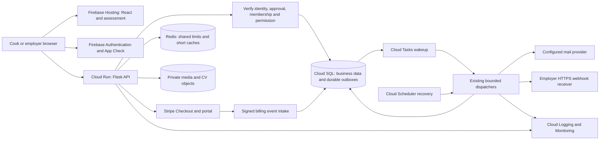

# Hiring architecture and operating boundaries

This document describes the existing Hiring implementation. It does not certify
security, unlimited capacity or completion of a live payment. Versioned release
and private acceptance records establish which code and behavior are deployed.
Home, Toque and the public company website are separate product surfaces, even
where they share identity, a repository or a provider account.

## Stack

| Component | Implementation | Source of truth |
| --- | --- | --- |
| Web application | React 19, React Router 7, Vite 7, Firebase Hosting | `frontend/package-lock.json`, `frontend/src/` |
| API | Python 3.12, Flask 3, Gunicorn, Cloud Run | `backend/Dockerfile`, `backend/requirements.txt`, `backend/routes/` |
| Business data | PostgreSQL in Cloud SQL, SQLAlchemy, versioned SQL migrations | `backend/models/`, `backend/migrations/`, `backend/services/database.py` |
| Shared request limits and short caches | Redis | `backend/extensions.py`, `backend/services/partner_rate_limits.py` |
| Identity | Firebase Authentication, Google or email sign-in; shared CookCredit identity project | `frontend/src/firebase.js`, `backend/middleware/auth.py` |
| Browser attestation | Firebase App Check with reCAPTCHA Enterprise where required | `frontend/src/firebase.js`, account-route middleware |
| Media and CVs | Private Google Cloud Storage objects; authorized, short-lived signed access | `backend/services/`, `backend/routes/hiring.py`, `backend/routes/business.py` |
| Assessment | Pinned published CookCredit Engine assessment and original overlay, with deployment/auth adapters | `frontend/scripts/hiring-assessment-release.json`, `frontend/scripts/copy-hiring-assessment.mjs` |
| Delivery | PostgreSQL outboxes, Cloud Tasks wakeups, Cloud Scheduler recovery | `backend/services/database.py`, `backend/services/webhook_dispatch.py`, `backend/services/operations.py` |
| Payments | Existing Stripe Checkout, signed billing webhooks and customer portal | `backend/routes/stripe.py`, `backend/services/stripe_service.py` |
| Mail | Existing durable account-mail outbox and configured provider; Hiring uses verified Workspace SMTP sender | `backend/services/account_email.py`, `backend/services/mail_transport.py`, `backend/services/customer_mail.py`, `CUSTOMER_EMAILS.md` |
| Monitoring | Structured Cloud Logging events, Cloud Monitoring alerts and public/readiness probes | `backend/services/operations.py`, `deploy/hiring_monitoring.py`, `OPERATIONS.md` |

Exact dependency versions come from the lockfile and requirements, rather than
the major-version summary above. Deployed environment flags, instance limits,
provider API versions and secret references must be read from the actual release.

## Data and access

PostgreSQL is the authoritative relational database. Its indexes support lookup;
it is not replaced by an application hash map or Redis. Firebase identifies a
person; it does not replace the API's company, seat and applicant-sharing checks.
The Hiring browser does not initialize Firestore as its business datastore.

Company-scoped queries and seat checks protect employer operations. An admin,
hiring manager, recruiter and viewer have different permissions. Platform-owner
approval/pricing controls are distinct from ordinary company administration.
Shared authentication across CookCredit products does not grant cross-product
record access. See [SECURITY.md](SECURITY.md) for the permission matrix and gaps.

Recordings and CVs are private. Consent and company access are checked before
issuing signed access. Hiring's media retention is bounded; keeping an original
during compression does not mean indefinite archival. The background compression
job preserves the original and uses the same authorization and expiry boundary.
Logs exclude tokens, signed URLs, recording paths, CVs and applicant payloads.

## Integrations and payment

Application links and the website widget use the existing role and application
flow. The generated widget includes explicit API and application origins;
approved website origins are checked by the API. The widget's public key is not
a server credential. Never embed a partner API secret in a website.

Server integrations use the versioned `/api/partner/v1` HTTP API. Credentials are
company-scoped, permission-scoped, environment-bound, hashed and revocable.
Idempotency keys prevent a retry from creating another assessment request.
Webhook secrets are encrypted, and HMAC signatures cover the exact JSON bytes.
Delivery is at least once: receivers must verify the signature and timestamp,
deduplicate the stable event ID, persist work and acknowledge promptly. Retries
and manual replay reuse the existing delivery record and event identity.

Team includes links, team review and embedding. The server API and signed
webhooks require Integration/Enterprise or explicitly included owner access.
Inspect the current catalog before quoting a price or changing a subscription.
Stripe shares a provider account with another product, but Hiring binds its own
customers, prices, metadata, endpoint and portal configuration. Never mutate
another product's Stripe setup during Hiring acceptance.

Billing events are verified and saved before processing. A redirect to a success
page is not payment proof. Reconciliation checks the authoritative subscription
and company binding; paid receipts use the existing mail outbox. Paid acceptance
requires a real authorized completed payment, correct access and receipt evidence.

## Fault detection and release

CI runs on pushes and pull requests. It uses disposable PostGIS for migrations
and backend regressions, runs frontend tests, builds Hiring and Home, audits
dependencies and scans Git history for secrets. The Hiring build also verifies
and packages pinned assessment assets. CI uses non-deployable build identifiers;
it has no production database, Stripe secrets or deployment credentials.

Deployment is a reviewed, scripted process, not automatic continuous deployment:
build an immutable image, verify CI, test staging, inspect a zero-traffic
production candidate, promote deliberately, then check live behavior and rollback
identifiers. A green CI run does not mean a deployment or a passed customer journey.

Monitoring covers API/readiness failures, bounded browser diagnostics, terminal
delivery failures, old pending queues, dispatcher heartbeats and public metadata.
Known recoverable email/webhook dependencies retain logs and retries before
paging; persistent failures and backlog still alert. See [OPERATIONS.md](OPERATIONS.md).
These checks can detect some failures before a customer reports them. They do
not continuously exercise every signed-in journey, inbox, phone or payment.

There is no verified automatic incident-triage-to-fix-PR agent in this repository.
Existing monitoring notifies the owner; diagnosis and repairs currently need an
engineer/Codex session. An agent is a separate workflow, not a capability implied
by having alerts or CI. A safe future workflow must reuse existing alerts, redact
logs, deduplicate incidents, reproduce the cause, test a narrow fix and open a
draft PR. It must stop for owner review, with no auto-merge, production deploy,
permission/secret change, payment, deletion or monitoring suppression. A local
desktop automation must not be described as laptop-independent incident response.

## Source backup and recovery

Published source is in GitHub. The default branch and a feature branch can point
to different releases; record the exact deployed commit, not just `main`. An open
PR is backed up on GitHub but is not merged or approved. Review the current PR
chain and protection settings before changing the release branch.

GitHub is a code backup, not a database, media or secrets backup. Customer records
live in GCP, secrets in Secret Manager, and media follows its configured retention.
Inspect successful database backups, point-in-time recovery and restoration
evidence separately. Private local incident records and approved media comparison
copies intentionally stay outside public Git; GitHub does not back them up.

## MCP and current API verification

MCP is a development-tool connection, not Hiring's runtime architecture. In a
Codex session, authenticated GitHub tools, official documentation, GCP APIs/CLI
and browser inspection provide current evidence. A supported REST API or CLI is
appropriate when it exposes the needed operation; wrapping it in MCP does not
make it more correct. MCP cannot guarantee the absence of hallucinations.

Before a change, inspect source and dependency versions, actual endpoint contracts,
deployed configuration and observed behavior. Confirm provider behavior in current
official documentation when it matters. Test the allowed path and relevant denied
paths, retain safe request/release references, and distinguish source evidence,
live verification, user-reported acceptance and checks that remain untested.
